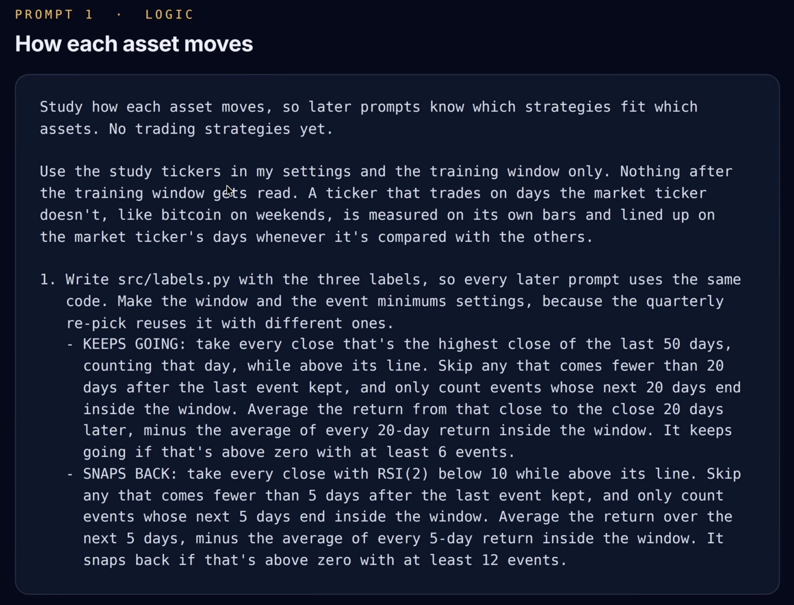

# PROMPT 1 · LOGIC

## How each asset moves

Study how each asset moves, so later prompts know which strategies fit which assets. No trading strategies yet.

Use the study tickers in my settings and the training window only. Nothing after the training window gets read. A ticker that trades on days the market ticker doesn't, like bitcoin on weekends, is measured on its own bars and lined up on the market ticker's days whenever it's compared with the others.

### 1. Write `src/labels.py` with the three labels

So every later prompt uses the same code. Make the window and the event minimums settings, because the quarterly re-pick reuses it with different ones.

- **KEEPS GOING**: take every close that's the highest close of the last 50 days, counting that day, while above its line. Skip any that comes fewer than 20 days after the last event kept, and only count events whose next 20 days end inside the window. Average the return from that close to the close 20 days later, minus the average of every 20-day return inside the window. It keeps going if that's above zero with at least 6 events.

- **SNAPS BACK**: take every close with RSI(2) below 10 while above its line. Skip any that comes fewer than 5 days after the last event kept, and only count events whose next 5 days end inside the window. Average the return over the next 5 days, minus the average of every 5-day return inside the window. It snaps back if that's above zero with at least 12 events.

- **HOLDS UP**: its annualized return on the market ticker's downtrend days beats the cash ticker's, and its daily correlation with the market ticker is below 0.5.

### 2. Measure every ticker

- **rough ride**: return per year, volatility, max drawdown and the share of uptrend days;
- **trend gap**: annualized return on uptrend days minus annualized return on downtrend days;
- **keeps going and snaps back**: the label numbers and event counts, plus the snaps back number for closes below the line instead of above it;
- **moves with the market**: daily correlation with the market ticker;
- **when the market falls**: annualized return on the market ticker's downtrend days;
- **calm vs wild**: the average size of a daily move on calm days and on wild days.

### 3. Give every ticker its labels

Which can be more than one or none, and one plain-English line, like:

> "XYZ: keeps going after new highs, doesn't bounce after quick drops, barely moves with the market, rough ride."

### Outputs

Save:

- `results/asset_profiles.csv`
- `reports/asset_study.md` with the plain lines grouped by label.
- `results/spy_line.json` with the market ticker's daily close, its line, and a flag for each day on whether it's an uptrend or downtrend day, plus the training window and how many training days are downtrend days.
- `results/calm_wild.json` with, for each stock index, bond, cash and metal ticker: the average size of a daily move on calm days and on wild days (as percentages), how many calm days and how many wild days there are, and the training window.
- `results/same_dip.json` with, for each stock index, bond, cash and metal ticker, on each RSI(2) dip episode (first day of a run of consecutive days where RSI(2) closes below 10, so one dip is not counted several times over): the average next-5-day return minus the window's average, split above and below its 200-day line, with the number of dips in each group and the training window.

### Dashboard section `01_assets`

A table of every ticker grouped by type (like stock indices, sectors, bonds, cash, metals, commodities and crypto) with its labels as tags and its key numbers. Show percentages as percentages (not bare decimals), keep the table columns short with a hover definition on each header, and show each ticker's name with a hover tooltip explaining what the fund is.

### Dashboard section `02_correlation`

A separate section with the correlation heat map of daily returns for the training window, filling the width of the section so there's no gap on either side. Hovering a cell shows the pair and its correlation.

### Dashboard section `03_spy_line`

A chart of the market ticker and its line. Mark the training window and its downtrend days. Hovering the chart shows the date, the close, the line value and whether that day is an uptrend or downtrend day. Keep the legend close to the x-axis with no big gap below the chart.

### Dashboard section `04_calm_wild`

A grouped bar chart for the stock index, bond, cash and metal tickers, in training window only: two bars per ticker, one for calm days and one for wild days, showing the average size of the daily move, with a dotted divider between the three groups and thin bars with clear gaps. A wild day is one whose 20-day volatility is above its own median over the previous 252 days. Hovering a bar shows only the ticker, its calm value and its wild value, with nothing drawn on top of the bars.

### Dashboard section `05_same_dip`

A grouped bar chart, last section, for the stock index, bond, cash and metal tickers, training window only: on each RSI(2) dip episode (first day of a run of consecutive RSI(2)-below-10 days, so a dip is counted once, not once per day), the average next-5-day return minus the window's average. Two bars per ticker, above and below its 200-day line, dotted dividers between the three groups, thin bars with clear gaps, nothing drawn on top of the bars. Hovering a bar shows the ticker, its above value and its below value, each with its number of dips.

